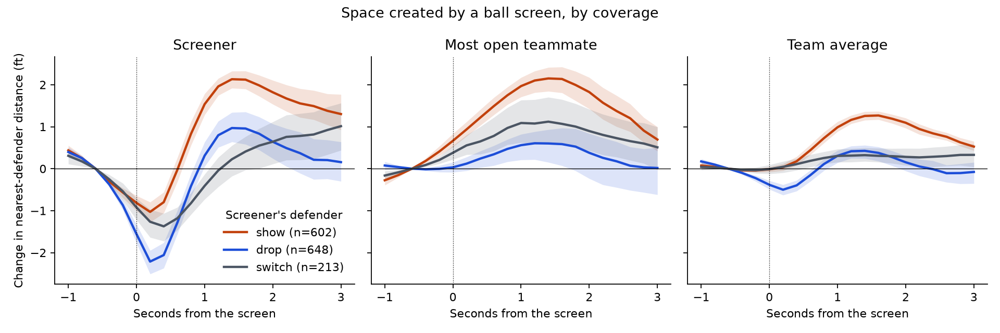
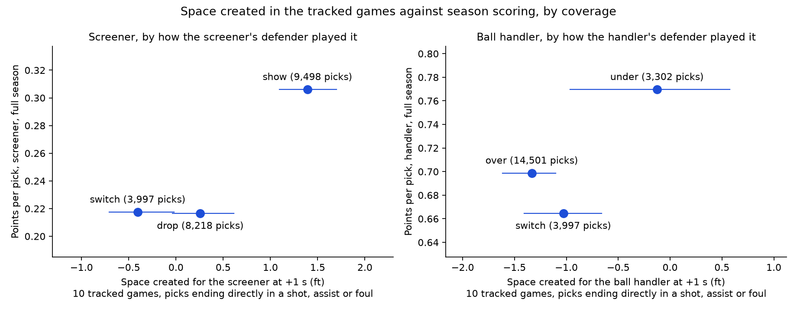

# The Price of a Coverage

**How much space does each way of guarding a ball screen give up, to whom, and for how long?**

An entry for the PySport Analytics Cup 2.0 (basketball), built only on SkillCorner's
open ACB 2025-26 data.

## Why this question

Every game plan includes a decision about ball screens: drop the big, show, or switch.
Coaches judge those choices by what they give up, and public numbers usually stop at
points per possession. Points are the last link in the chain. The first link is space:
who gets open, by how much, and how quickly the defence gets it back. Tracking data can
measure that directly, so I did.

I started somewhere else. My first idea was that a defender's closing speed and angle
would predict makes better than distance alone. Ten games could not show it: on 1,278
shots, even the supplied defender distance barely predicted makes. That failure pointed
to the better question. Makes are noisy and rare; space is measured for every player in
every frame.

## What I did

1. **Openness.** For every offensive player in every frame, the distance to the nearest
   defender. A measurement only counts when SkillCorner's own error estimate for both
   players is 3 ft or less. Anything else is left out, never treated as zero.
2. **Space created.** For each of 1,520 ball screens (and 2,465 handoffs, off-ball
   screens, drives, isolations and post-ups), the change in openness from 0.6 seconds
   before the action to each moment up to 3 seconds after, for the ball handler, the
   screener, the most open other teammate, and the team average. A window stops when
   the scoring chance ends.
3. **Honest ranges.** Actions in the same game are not independent, so every range
   comes from resampling whole games, and coverage labels are shuffled only within a
   game. Random moments with no action serve as a control.
4. **A check that does not use the labels.** SkillCorner derives its coverage labels
   from the same tracking, so I also measured how far below the screen the screener's
   defender stands, in feet, and asked whether space created follows that number.
5. **Price.** Season points per pick by coverage, from SkillCorner's aggregates
   (about 22,000 picks that led directly to a shot, assist or foul).

## What I found



One second after the screen, a **show** has opened 0.99 ft of space per offensive player
(range 0.88 to 1.12); a **drop** has opened 0.31 ft (0.14 to 0.43). The difference,
0.68 ft per player, has the same sign in all 10 games and survives every setting I
varied. The screener gains 1.5 ft against a show and 0.3 ft against a drop, and the most
open teammate gains 2.0 ft against 0.6 ft. Showing does not keep the handler contained either: two
seconds on, he is back within 0.2 ft of where he started against a show, but 1.2 ft
tighter against a drop.

The label-free check agrees. Drops sit a median 5.4 ft below the screen and shows 2.4 ft.
Space created is about 1 ft when that defender is within 3 ft of the screen, half that
at 3 to 6 ft, and nothing beyond 6 ft.



The roles that gain space are the ones that score. Over the season, screeners produce
0.31 points per pick against a show and 0.22 against a drop; handlers produce 0.77 when
their defender goes under the screen and 0.70 when he goes over.

## What this does not show

- Coverages are chosen, not assigned. Teams show against some handlers and drop against
  others, so these numbers describe what happened, not what switching coverage would do.
- Space is not points. The scoring link is by coverage across a season, not pick by pick.
- The screener's own gain against a show is close to how a show is defined. The teammate,
  team-average and depth results carry the argument.
- Ten games, one league, one season. Blitz and ice appear too rarely to say anything.

## Open-source potential

The package is small and reusable: a loader for SkillCorner's basketball format (which
`kloppy` does not document support for), an openness measure with an explicit quality
gate, and an event-study engine that works for any action or coverage, with
game-resampled ranges built in. A natural next step is contributing the loader to
`kloppy` and running the same study on more games.

## Reproduce

Requires [uv](https://docs.astral.sh/uv/), `git` and [git-lfs](https://git-lfs.com).
The data (about 400 MB) is downloaded at a pinned version and is not part of this
repository.

```bash
uv sync
bash scripts/download_data.sh
uv run coverage-price reproduce
```

This writes every table to `results/tables/`, both figures to `results/`, and a run
summary to `results/summary.json`, in under a minute. To redraw a typical ball screen
as moving dots:

```bash
uv run coverage-price replay --coverage show --out results/replay_show.gif
```

Run the tests with `uv run pytest`.

Data: [SkillCorner Open Data, Basketball](https://github.com/SkillCorner/opendata-basketball).
Licence: MIT, see `LICENSE.md`.
